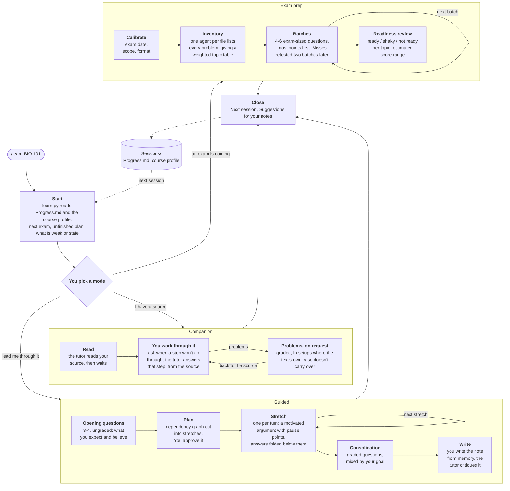
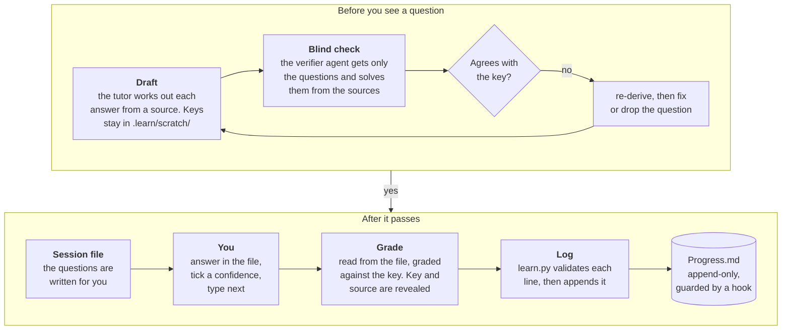

# learn-tutor

A tutor for [Claude Code](https://claude.com/claude-code). It finds exactly where your knowledge stops and pushes it outward, for any subject, in plain Markdown files you own.

```
/learn BIO 101                    study the next chapters of a course
/learn BIO 101 exam               prepare for the course's next exam
/learn the French Revolution      learn any topic
/learn BIO 101 companion          work through the chapter yourself, the tutor on call
```

What makes it different from asking a chatbot to explain something:

- **You produce, it grades.** Learning happens when you attempt an answer and get feedback. The tutor asks, you answer in a file, it grades against a key.
- **Grounded.** Every graded question has a worked answer and a cited source before you see it, and a second agent that never sees the key solves it independently. Disagreements are fixed before the question reaches you.
- **Understanding over memorizing.** Guided mode builds each subject from a few facts you can accept without caveats and walks every result as "how could I have discovered this?".
- **It stays out of your way when you have a good source.** Companion mode answers the step you're stuck on and makes problems only when you ask.
- **You write your own notes.** The tutor critiques them against the sources. It never writes or edits them.
- **It remembers what you can do**, not what you've read: one line per graded question in `Sessions/Progress.md`, used to pick up at your frontier next time and to bring back what's weak or stale.

Why it is built this way, and the research behind it: [DESIGN.md](DESIGN.md).

## Install

Needs Claude Code and Python 3 (already on most Macs and Linux machines; on Windows, install it from python.org).

In Claude Code:

```
/plugin marketplace add LiamI16/learn-tutor
/plugin install tutor@learn-tutor
```

The command is `/learn`. If another skill on your machine is also called `learn`, use the full name `/tutor:learn`.

**Updates.** Run `/plugin marketplace update learn-tutor`, then restart Claude Code. To get updates automatically, turn on auto-update for `learn-tutor` in the `/plugin` menu, under marketplaces; it checks when Claude Code starts. While the repository is private, background updates may need a GitHub token in your environment; the manual command always works with your normal git login.

<details>
<summary>Install without the plugin system</summary>

Copy the skill and the verifier into your Claude folder:

```bash
git clone https://github.com/LiamI16/learn-tutor
mkdir -p ~/.claude/skills ~/.claude/agents
cp -R learn-tutor/skills/learn ~/.claude/skills/learn
cp learn-tutor/agents/verifier.md ~/.claude/agents/verifier.md
```

The command is the same, `/learn`. This skips the hook that keeps `Progress.md` append-only (the tutor is told to follow that rule either way).
</details>

## Set up a study folder

Pick one folder for everything you study and always start Claude Code from it:

```
Study/
  Materials/
    BIO 101/            textbook, slides, homework, past exams (PDF or text)
      Held Out/         practice exams you haven't taken yet (see below)
  Sessions/             created by the tutor: session files, course profiles, Progress.md
  ...your own notes, anywhere else, as Markdown
```

Only the folder itself is required. The tutor creates `Sessions/` on first use, and works without materials (it then uses the web and asks you for sources), but it is much better with them.

A good editor matters, because everything with math, tables or diagrams happens in the session file, not the terminal. **[Obsidian](https://obsidian.md) is recommended** (free): open the study folder as a vault and questions, math, diagrams and collapsible feedback all render, and the tutor scrolls the file to what's new. Any Markdown editor works, but callouts then show as plain quote blocks. That matters most in guided mode, whose answers sit in folded callouts below each pause point: in another editor they're open, so answer each prompt before reading on.

```bash
cd ~/Documents/Study
claude
```

Press Shift+Tab to switch to "accept edits", so the tutor can write to the session file without asking each time. When it first runs its bookkeeping script (`python3 …/learn.py`), choose "don't ask again".

## A session

1. `/learn <course or topic>`. You pick a mode (or name it in the line: `companion`, `guided`, `exam`), and the tutor asks what's in scope (and, for a course, whether an exam is coming).
2. It opens a session file. **Answer there**, tick a confidence box *before* seeing any feedback, then type `next` in the terminal.

   ```markdown
   #### ==Q2== Glycolysis `L3` `Campbell §9.2`
   Why does glycolysis need NAD⁺ to be regenerated to keep running?

   ##### Answer
   (type here)

   ###### Confidence
   - [ ] high
   - [x] med
   - [ ] low
   ```
3. Feedback appears under each answer with the key and its source, so you can check the tutor too.
4. Graded results are logged after every batch, so stopping early loses nothing.

**Companion**, for when you have a source (a textbook chapter, a paper, a lecture) and want to work through it yourself. The tutor reads it first, then waits. When a step won't go through, ask: it answers that step only, grounded in the source, and says plainly if the source looks wrong. It never makes problems unless you ask; `problems` gets a graded set aimed at the source's key moves in setups where the text's own case doesn't carry over. Also on request: `frame` (a reading guide: the puzzle and one question per section), `walk me through <section>`, `skeleton` (write the argument's key moves closed-book and compare), `critique <note>`.

**Guided**, for when there is no good source, the field is new to you, or you want to be walked through. A few ungraded opening questions, then a small map of the material cut into **stretches**. Each stretch is one continuous, motivated piece, like a good textbook section, with two to four pause points at the steps that matter: *Predict* the next move, *Explain* why a step is allowed, or *Do* it yourself. The text after each pause point is folded, so you answer, unfold, and read on at your own pace. The tutor narrates more or hands over more depending on how the pause points go. After the last stretch, a short graded **consolidation** set, then you write the note from memory and the tutor critiques it. Type `probe` instead to find out where you stand on a topic before deciding what to study.

**Exam prep** (`/learn <course> exam`, or offered when an exam is within three weeks): the first session reads every file in the course's materials and builds a topic table weighted by what the homework and past exams actually ask. Batches of exam-sized questions go after the most points first. Each question has a `Minutes:` line; fill it in and the tutor compares it with the exam's time per problem. Miss the same kind of problem twice and the next one comes as a step-by-step walkthrough you work through, not another fresh problem. Each session ends with a readiness review per topic and an estimated score range. Ask for a mock exam any time.

**Held-out exams.** Put a practice exam you want to save in `Materials/<Course>/Held Out/`. The tutor uses it only to weight topics and match question style. It never shows or adapts its problems, until you ask to take it as a mock exam.

### Controls

| Type | Effect |
|---|---|
| `next` | grade / continue |
| `skip` | skip the current item |
| `stop` | grade what's filled in, then close the session |
| `defer` | guided: write the current note later |
| `narrate` / `let me try` | guided: more narration, or more left to you |
| `explain more` | more depth on the current step |
| `probe` | find where you stand on a topic: a graded check ending in a list of what to review |
| `problems [n] [on <what>]` | companion: a graded problem set |
| `frame` · `skeleton` · `walk me through <section>` · `critique <note>` | companion: see above |
| anything else | a plain question |

## How it works

A session, start to close. Each session starts from what the previous ones recorded.



Everything the tutor writes for you (questions, stretches, answers to your questions) is checked before you see it, and graded questions are logged after:



Then the next turn starts again at Draft. While you are answering, a background agent has already drafted and checked the next items that don't depend on your answers, so there is little waiting after `next`.

## Files

| File | What it is |
|---|---|
| `Sessions/YYYY-MM-DD <name>.md` | one per session: questions, your answers, feedback |
| `Sessions/<Course>.md` | course profile: exams, terminology, answer style, sections covered, topic table. Edit it freely |
| `Sessions/Progress.md` | one line per graded question. Append-only |
| `.learn/scratch/` | the tutor's temporary files (answer keys, text extracts). Safe to delete between sessions |
| `.learn/config.json` | optional settings, below |

`Sessions/` holds data about you; your notes hold knowledge. The tutor keeps them separate: it never edits your notes, and in an Obsidian vault it writes no links or tags in `Sessions/`, so your graph stays clean.

### Settings

Optional `.learn/config.json` in the study folder:

```json
{
  "sessions": "Sessions",
  "materials": ["Materials", "~/Documents/School"],
  "open": "auto"
}
```

- `materials`: folders searched for one named like the course or topic. Folders outside the study folder also need to be allowed in Claude Code (`claude --add-dir ~/Documents/School`).
- `open`: how the session file is opened. `auto` (Obsidian if the folder is a vault, VS Code inside its terminal, else the system default), `system`, `none`, or a command such as `"code -g {file}:{line}"`.

### Obsidian extras

- Scroll-to-what's-new uses Obsidian's command line interface: turn it on in Settings → General → Advanced. Without it the file opens at the top.
- Optional theme for session files: copy [`extras/obsidian/learn-sessions.css`](extras/obsidian/learn-sessions.css) to `<vault>/.obsidian/snippets/` and enable it in Settings → Appearance → CSS snippets.
- For PDFs, installing `poppler` (`brew install poppler`, `apt install poppler-utils`) lets the tutor read just the chapters in scope instead of whole books.

## What's in this repo

```
.claude-plugin/                 plugin and marketplace manifests
skills/learn/SKILL.md           shared core: rules, probe, question format, grounding, grading, Progress, close
skills/learn/companion.md       companion mode
skills/learn/learning.md        guided mode
skills/learn/exam.md            exam prep mode
skills/learn/scripts/learn.py   bookkeeping: session-start state, Progress validation, review status
agents/verifier.md              the blind solver: gets the questions, never the answer keys
hooks/                          keeps Progress.md append-only
extras/obsidian/                optional theme
tests/                          python3 -m unittest discover tests
```

The behavior is all in the four Markdown files under `skills/learn/`. To change how the tutor acts, edit those; see "Changing the tool" in [DESIGN.md](DESIGN.md). To develop locally: `claude --plugin-dir .`.

## Status

Generalized from a Claude Code skill used for real course work, and kept in sync with it. The bookkeeping script and hook are covered by tests, and the plugin passes `claude plugin validate`. Companion and guided mode have each been run end to end on a test source with a simulated learner. Exam prep has only been used in the original version, not yet in this one.

An older Gemini CLI version (two modes, learning and exam prep, without companion mode or stretches) is archived at the [`archive/gemini` tag](https://github.com/LiamI16/learn-tutor/tree/archive/gemini). It is no longer maintained.

## Credits

Guided mode's two principles are adapted from [amosblomqvist/learn](https://github.com/amosblomqvist/learn), whose one-idea-per-turn loop it started from.
